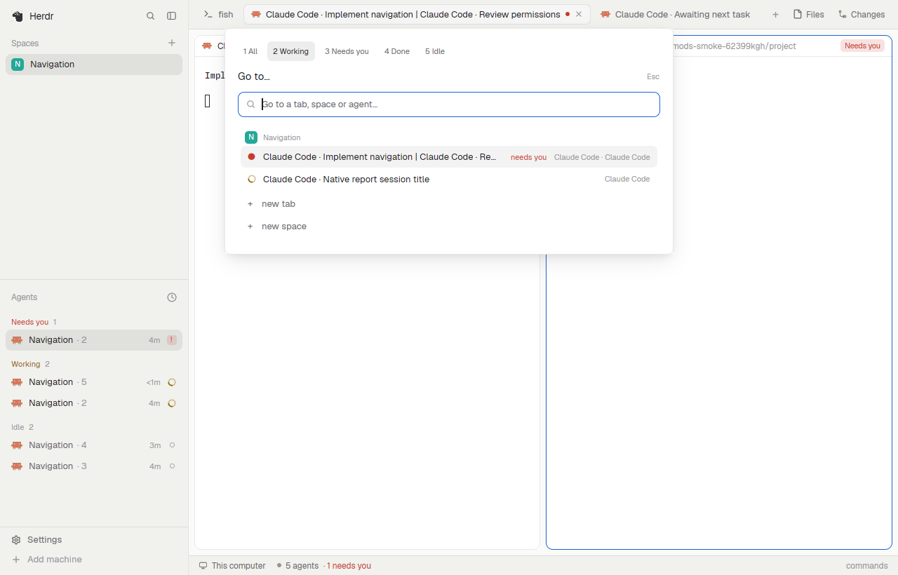

# Herdr Navigation

Mods for Herdr App: Smart Tabs, Agent Picker, Agent Cards, and Space Shortcuts. They use the App's mod API and require no Rust patches or changes to herdr-core.



## Smart Tabs

Each terminal pane contributes its program name. Agent panes also show their session title when available. Multiple panes are joined with ` | ` in pane order. Labels are capped at 80 Unicode code points, including the ellipsis, and at 480 pixels; the tooltip contains the full title.

Descriptive saved tab names take precedence. Herdr stores `shell` and launch-program names as named tabs, so those names are treated as automatic. A manual name equal to a current program name has the same treatment. Clear a saved name to return to automatic titles. Display updates do not rename tabs or write layout state; only [pinned tabs](#pinned-tabs) open and move tabs.

Agent title sources, in priority order:

1. A valid, unexpired `nix.activity` integration label, when installed.
2. The agent's native OSC 7501 report title.
3. The terminal title set by the program.

No integration label is required. If an agent reports no title, the tab shows its program name. Mod panes show their mod identifier.

## Pinned tabs

Another mod can provide a tab type: a mod that shows its own view in a tab pane. A pinned tab opens that tab type in every space automatically. With nothing configured, Smart Tabs behaves as before.

Declare pinned tabs with the Home Manager module:

```nix
programs.herdr-navigation.pinnedTabs = [
  { label = "Board"; mod = "my-board"; }
];
```

The module writes the list to `mods/tabs-enriched/pinned.json` as `[{ "label": "Board", "mod": "my-board" }]`. Without Home Manager, write that file yourself. An entry has only a tab name and a mod. Smart Tabs passes no props, so the provider owns its settings.

When a space is shown without one of its pinned tabs, Smart Tabs runs `tab.new { space, name: label, mod }`, then selects the tab you were on again. Pinned tabs stay first, in configured order, and they are real tabs: Ctrl+number, the picker, and tab state work as they do for any tab. A pinned tab shows only an icon, with no text: no title, zoom marker or status. Its name appears only in the tooltip, and it has no close button. A divider separates pinned tabs from ordinary tabs. Smart Tabs does not change other tabs, their names, or any layout.

Herdr gives mod panes no program icon, so the icon comes from the provider. Smart Tabs draws `mods/<mod>/tab-icon.svg` in full colour when it exists, else `mods/<mod>/icon.svg` tinted to the tab's text colour, else Herdr's pin glyph. An ordinary tab holding a mod pane shows the same icon before its title, unless the tab already shows a program icon. Until it finds `tab-icon.svg`, Smart Tabs looks for both files again every 2 seconds while tabs render, so an icon written after Smart Tabs loads still appears.

### Pin and Unpin

Right-click a tab for Smart Tabs' tab menu: Herdr's Rename, New tab and Close, plus pinning. A pinned tab's menu has New tab and Unpin, but no Close or Rename. An ordinary tab holding a mod pane has Pin. Terminal tabs cannot be pinned.

- Pin applies in every space, like a configured entry. Its label is the tab's name. An unnamed tab is first renamed after its mod's pane title, or the mod name when the pane has none, because its number changes as tabs move.
- Unpin applies in every space. Each copy stays open as an ordinary tab that you can close, and new spaces no longer get one.

`pinned.json` is read-only under Home Manager, so menu changes go to Herdr's shared state under the key `tabs-enriched.pins`, saved in `shared.json` as `{ "added": [...], "removed": [...] }`. Pinned tabs are the configured entries minus `removed`, then `added` in the order they were pinned. Unpinning a configured entry lasts across restarts until the entry leaves `pinned.json`. When Smart Tabs next loads and reads a `pinned.json` without that entry, it forgets the unpin, so adding the entry back pins it again. A missing `pinned.json` forgets nothing: Home Manager deletes the file when `pinnedTabs` is empty, and it can be briefly absent during activation.

Gotchas:

- Smart Tabs finds a pinned tab by its name and its mod pane. Renaming a pinned tab turns it into an ordinary tab, and a new pinned tab opens. Rename is off for pinned tabs, by double-click and in the menu.
- A pinned tab closed another way, for example with `tab.close`, opens again. Unpin it first.
- If a pinned tab cannot open, for example because its mod is not installed, Herdr logs the error and Smart Tabs tries that space again only after the mod reloads.
- Pinned tabs open in a space when it is first shown. While a space still has a pinned tab, closing its last ordinary tab does not close the space; close the space from the sidebar.

### Provider contract

A provider is an ordinary mod, for example `mods/my-board/main.js` with `{ "place": "none" }` in `mod.json`, plus an optional icon for its tab: a one-color `mods/my-board/icon.svg`, drawn with `svg()` in the tab's text colour, or a full-colour `mods/my-board/tab-icon.svg`, drawn with `image()`. `tab-icon.svg` wins when both exist. `svg()` turns any SVG into a one-color silhouette, so a picture (for example a PNG wrapped in an SVG) belongs in `tab-icon.svg`. Either icon must be a regular file, not a symlink: Herdr App draws nothing for a symlinked SVG, and Home Manager installs files as symlinks. Smart Tabs ignores a symlinked `tab-icon.svg`. A provider installed that way can write the icon itself when it loads, as herdr-hermes-shepherd does. It renders its view in the tab's pane and reads its own state from `shared`, `localStorage`, or files. Every space has its own copy, so keep data that must be identical across spaces in `shared` state. Only the copy in the shown tab receives `<mod>.<command>` key commands.

A provider adds buttons to the top-right of the tab bar, before Files and Changes, by publishing a list under the shared key `tab-controls:<mod>`:

```js
setShared("tab-controls:my-board", [
  { id: "cron", label: "Cron", icon: "mods/my-board/clock.svg", command: "my-board.cron" },
  { id: "chat", label: "Chat", command: "my-board.chat", active: true },
]);
```

Smart Tabs shows these controls while the shown tab contains a pane of that mod, whether the tab is pinned or not. A click runs `run(command, args ?? {})`, so `my-board.cron` reaches the shown copy's `nextCommand()` as `cron`. `label` and `command` are required; an entry without them is skipped. `id` keeps a control's identity across updates; without one, its position in the list does. `icon` is an optional tinted SVG path, and `active: true` draws the selected style. Publish the list again to change it, for example when a control's `active` state changes.

## Agent Picker

Open `picker-enriched` to search tabs by their displayed titles, saved names, space names, and agent program names. State filters combine with the text query.

| Shortcut | Filter |
| --- | --- |
| Ctrl+1 | All tabs |
| Ctrl+2 | Working |
| Ctrl+3 | Needs you |
| Ctrl+4 | Done |
| Ctrl+5 | Idle |

The filter chips are clickable. A tab matches if any of its agents has the selected state, even when another agent determines the tab's aggregate status. Shell-only tabs appear only under All. Herdr changes Done to Idle after you view the agent.

Arrow keys select a row, Enter opens it, Escape closes the picker, and Ctrl+D closes the selected tab. New-tab and new-space actions remain available, including when no agent matches.

## Agent Cards

`agents-enriched` replaces Herdr's agents list in the sidebar. Each agent is a card with its harness icon, session title, status, and time since its state changed. Below the title, a blocked agent shows why it needs you, wrapped to as many lines as it takes. The reason is the agent's own blocked report message, else its kind (permission, question, sign-in), else "Needs attention". The whole message is shown. Other agents show their active task when the `nix.activity` integration reports one, with the checklist count, for example `2/5 · Writing tests`.

The chevron on a card shows or hides its details: the full title, the checklist count and active tasks (for example `3/7 done · Writing tests · Updating the changelog`), model, workspace and folder, branch, and sub-agents. A detail nobody reported says so, as "Not reported", "None reported" or "No branch". Cards start collapsed. A card stays as you left it while its agent is listed, and a status change never opens or closes it. Sub-agents are of two kinds. "Child terminals" are Core terminals, listed with their status, and a click peeks at that terminal. "Reported sub-agents, no terminal" are the ones the agent runs inside itself and only reports, listed as text with their type and description. They have no terminal to open, and an id the agent gives them is never taken for one. A card with child terminals shows their count, coloured by the most urgent child. A blocked child moves its parent into Needs you, and the parent's card says why under its title, as `reviewer: <reason>`, with the same fallback to "Needs attention". The child's row in the details shows its reason too.

Click a card to focus its terminal. Clicking the chevron only toggles details. Permission prompts stay in the terminal; cards have no approve or deny buttons. Hovering a card shows a tooltip with its title, reason or task, model, branch, folder, and its reported sub-agents, with their number when the integration gives it. All of it is also on the card or in its details, which Space or the chevron opens without a pointer.

Alt+A, from the repository's `keys.json` fragment, gives the list the keyboard; Tab stays in the terminal. Clicking the space between cards does the same, and Escape goes back to the agent on screen. Up and Down move between group headers, cards, and the child terminals of expanded cards. The list keeps the selection in view, also when cards above it grow or new rows appear, until you scroll with the wheel, the thumb or the page keys. Page Up, Page Down, Home and End scroll the list, so a reason taller than the list can be read to its end. On a header, Enter or Space folds or unfolds the group; Left folds it and Right unfolds it. On a card, Enter focuses its terminal, Space shows or hides its details, and Right and Left show and hide them. On a child, Enter peeks at it. A key bound to `agents-enriched.details` shows or hides the details of the card under the keyboard, or of the card a selected child belongs to, else of the agent on screen. The fragment doesn't bind `agents-enriched.details`. The scroll thumb can be dragged, and the wheel scrolls the list.

The sort button is the first stop in that order, above the first header. Enter or Space on it opens the sort menu, where Up and Down choose a view, Enter or Space selects it and Escape closes the menu.

In the narrow rail, Alt+A works the same way: Up and Down move between the numbered agents and the » control below them, Enter focuses an agent's terminal, and Enter on » widens the sidebar back to cards.

The sort button keeps Herdr's two views: Priority, with Needs you, Done, Working and Idle sections, and Grouped by space. Ordering, Done becoming Idle once viewed, and the order `agent.next` and `agent.prev` follow are Herdr's. Herdr's agents list let you pin agents to the top; Agent Cards has no agent pins and ignores pins Herdr saved. Tab pinning in Smart Tabs is unrelated and unchanged. The narrow sidebar rail shows Herdr's numbered rows.

The label's optional `details` field fills the expanded card where the integration reports it: a full title of up to 300 characters, model, the agent's working directory and branch (which take precedence over the pane's), checklist counts with up to five active tasks, and up to eight reported sub-agents with their total. The card's title stays the token title the tab shows. Each detail field is checked on its own against the reporter's limits; one that is malformed or too long is ignored. The tokens then fill in title, model and tasks, and the pane fills in folder and branch. Reports without `details` read as before.

Without the integration, or when its label has expired, belongs to another program, is malformed or has been cleared, cards use Herdr's native data, details included: the agent's report title, then the tab name, then the program name. Model then reads "Not reported" and Task "None reported". Cards read the label afresh on every redraw. When the reporter replaces the label for a new session, nothing from the old one stays.

## Space Shortcuts

`spaces-enriched` is Herdr's spaces sidebar with two buttons before the local `+`. When another machine is known, the buttons sit on the This computer row; otherwise they sit in the Spaces header. The narrow sidebar rail hides them. They work only on this computer.

Open workspace asks for a folder in the system folder picker. If a local space was made in that folder, Herdr selects it. Otherwise it opens a new space named after the folder. A main checkout kept as `<repo>/<branch>` is named `repo/branch`.

New worktree asks for a branch of the repository where the active space's first terminal is. A worktree that already has the branch is reused. An existing branch is checked out unchanged, and a new branch starts from HEAD. New checkouts go to `<repo folder>/<branch>`, next to the main checkout. The space is named after the branch, and an existing space in that checkout is renamed to it.

Before opening a folder whose own `.envrc` direnv has not allowed, the `space-open` dialog asks first. Allow & open runs `direnv allow`, Open only opens the space without it, and Cancel opens nothing. Without direnv installed, the dialog skips this step.

## Install with Nix

Add this repository as a flake input named `herdr-navigation`, then import its Home Manager module:

```nix
imports = [inputs.herdr-navigation.homeManagerModules.default];
```

The module installs only the mods. It does not replace your keys, settings, layouts, or runtime state.

Merge `inputs.herdr-navigation.lib.keys` into your existing Nix-managed key object with `lib.recursiveUpdate`. The fragment opens the picker with Alt+W, gives the agents list the keyboard with Alt+A, and suppresses Herdr's default Ctrl+1–5 navigation only inside the picker, allowing those keys to reach its state filters. Preserve the rest of your key configuration.

In your chosen layout, replace the tabs block's mod identifier `tabs` with `tabs-enriched`, the spaces block's `spaces` with `spaces-enriched`, and the agents block's `agents` with `agents-enriched`. Keep these changes declarative and rebuild your system or Home Manager configuration to apply them.

The optional `navigation/layouts/navigation.json` provides a complete layout based on Herdr's main layout. To install it through Home Manager:

```nix
xdg.configFile."herdr-app/layouts/navigation.json".source =
  "${inputs.herdr-navigation}/navigation/layouts/navigation.json";
```

Select the Navigation layout after activation if you installed it. Each mod ships as one JavaScript file so Home Manager store symlinks do not require relative JavaScript imports.

## Verification and publishing

Development checks used Herdr App 0.1.11 and Core 0.1.16 on Linux in a private display and Core session. The mod loader checks and live picker interactions ran through Nix-store file symlinks. No Windows or macOS runtime checks have been performed.

The preview uses synthetic agent reports, not private sessions. `node --test` checks the Space Shortcuts naming, worktree lookup, and direnv rules, and how Smart Tabs reads pinned tabs, combines configured and menu pins, builds the tab menu, and decides which tabs to open or move. It also checks what Agent Cards shows from native and `nix.activity` data, its attention reasons, its order and sections without agent pins, and which expanded cards it keeps. Before updating the mods, run `herdr-app check` on each mod folder and exercise the visible App behavior in an isolated session. Keep the title helper in both self-contained modules consistent.

Herdr's community catalog discovers public GitHub repositories with the `herdr-layout` topic. The `navigation/` folder contains the layout, mods, recipe, and preview required by the catalog. Publishing the repository and setting the topic are separate from installing it locally.

Derived from Herdr App under Apache-2.0. See `NOTICE` and `LICENSE`.
